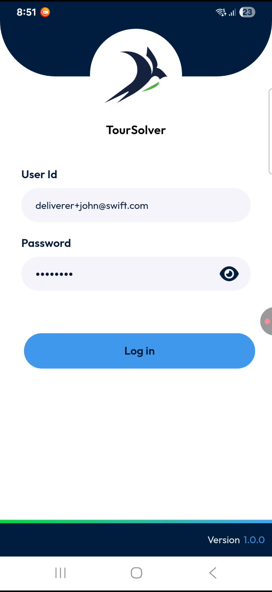

# Accedi

### Per iniziare

Per garantire la migliore esperienza con l'app Nomadia TourSolver, controlla i requisiti di sistema per il tuo dispositivo.

* **Requisiti di sistema** L'app Nomadia TourSolver è progettata per funzionare su vari dispositivi mobili. Per garantire la migliore esperienza, verifica se il tuo dispositivo soddisfa i seguenti requisiti:
  * **Android** i dispositivi devono eseguire **versione 8 a 14**.
  * **iOS** (Apple) i dispositivi devono eseguire **versione 15.5 o successiva**.
* **Passaggi di installazione e configurazione** Ottenere l'app Nomadia TourSolver sul tuo dispositivo è rapido e semplice!
  1. **Scarica l'app**: Puoi scaricare l'app Nomadia TourSolver da **App Store iOS** (per dispositivi Apple) o da **Google Play Store** (per dispositivi Android).
  2. **Avvia l'app**: Dopo il download, trova l' **icona TourSolver** sulla schermata principale del tuo dispositivo e **toccalo** per aprire l'app.

.png>)

* **Configurazione iniziale: panoramica della schermata di accesso** Quando avvii l'app per la prima volta, vedrai sempre la **schermata di accesso**. Questa schermata è dove inserirai le tue informazioni per accedere all'app. Comprende diversi elementi chiave:
  * **Campo ID utente**: Qui inserirai la tua identificazione utente unica.
  * **Campo password**: Qui inserirai la tua password segreta.
  * **Pulsante blu di accesso**: Situato al centro della schermata, dovrai toccare questo pulsante dopo aver inserito i tuoi dati.
  * **Numero di versione dell'app**: Lo troverai visualizzato nell'angolo in basso a destra della schermata.

### Spiegazioni delle funzionalità con vantaggi

* **Interruttore di visibilità della password (icona occhio)** Il **il campo password** presenta un comodo **icona a forma di occhio**. Questa funzione ti permette di **attivare/disattivare la visibilità della password digitata**. Ciò significa che puoi vedere temporaneamente i caratteri che stai digitando per assicurarti di non aver commesso errori, quindi nasconderli di nuovo per sicurezza.
  * 💡 **Suggerimento**: Usa l'icona a forma di occhio per ricontrollare la tua password prima di toccare **Accedi**, soprattutto se stai avendo problemi a effettuare l'accesso!

### Attività comuni con passaggi dettagliati

* **Accesso all'app** La tua **ID utente e password** sono impostati dal tuo **amministratore back office TourSolver**. Se hai bisogno di **cambiare la tua password**, ti preghiamo di **contattare direttamente il tuo amministratore** . Ecco come accedere:
  1. **Inserisci le tue informazioni**: Tocca il **campo ID utente** e digita il tuo ID utente. Poi, tocca il **campo password** e digita la tua password.
  2. **Tocca Accedi**: Una volta che entrambi i campi sono compilati, **tocca il pulsante blu Accedi**.

3. **Accesso riuscito**: Se il tuo ID utente e la tua password sono corretti, sarai **autenticato con successo e connesso all'app**.

* **Risoluzione dei problemi: accesso non corretto** A volte potresti digitare male o dimenticare la password. Non preoccuparti, l'app te lo segnalerà!
  * Se il **nome utente o la password che hai inserito è errato**, apparirà un messaggio di errore che indica "**Nome utente o password non corretti**". Questo messaggio verrà visualizzato tra il campo password e il pulsante di accesso.
  * ⚠️ **Avviso**: Se vedi questo messaggio, ricontrolla il tuo ID utente e la password per errori di battitura e assicurati che il tasto Bloc Maiusc non sia attivato accidentalmente.

### Suggerimenti per la produttività

* 💡 **Gestione delle password**: Ricorda sempre che il tuo **amministratore back office TourSolver** è il contatto principale per qualsiasi modifica o problema relativo alle password. Non esitare a contattarli se hai problemi di accesso persistenti.
* 💡 **Controllo rapido**: Usa il **icona a forma di occhio** accanto al campo password per verificare rapidamente l'inserimento della tua password prima di toccare **Accedi**. Questo può farti risparmiare tempo se tendi a commettere errori di battitura.
