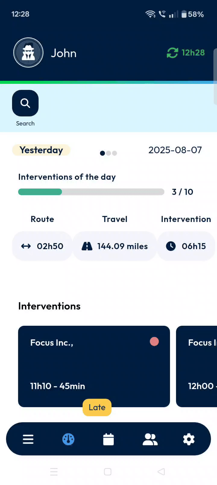

# Annulla

### 1. Introduzione

Si prega di notare che questa guida si concentra specificamente sulla funzione "Annulla Intervento". Informazioni sui requisiti di sistema, i passaggi di installazione o la configurazione iniziale di TourSolver Mobile non sono disponibili nelle fonti fornite \[i, j].

### 2. Comprendere gli Interventi e la Cancellazione

In TourSolver Mobile, un "intervento" si riferisce a un'attività o compito che è necessario completare. A volte, le circostanze cambiano e potrebbe essere necessario annullare un intervento che hai avviato o che stavi per iniziare. Questa guida ti guiderà attraverso i semplici passaggi per farlo.

### 3. Annullare un Intervento

Prima di avviare un nuovo intervento o annullarne uno esistente, è fondamentale assicurarsi di aver completato eventuali interventi attualmente contrassegnati come "in corso". Devi terminare tutti gli interventi in corso prima di passare al successivo.

Ecco come abbandonare un intervento in TourSolver Mobile:

1. **Accedi all'Intervento dal tuo Cruscotto**
   * Per iniziare, devi aprire lo specifico intervento che desideri abbandonare.

2\. **Individua e Tocca il Pulsante Abbandona** \* Una volta aperto l'intervento, se decidi di annullarlo, cerca il pulsante dedicato.

3\. **Conferma la Cancellazione**\* Dopo aver toccato il pulsante di annullamento, apparirà una finestra pop-up sullo schermo per confermare la tua azione. Questa è una misura di sicurezza per prevenire abbandoni accidentali.

4\. **Verifica l'Annullamento**\* Una volta che confermi, il sistema elaborerà la tua richiesta.

### 4. Suggerimenti per la produttività

Suggerimenti specifici sulla produttività oltre al processo "Annulla Intervento" non sono forniti nei materiali di origine per questa guida \[i, j]. Tuttavia, utilizzare in modo efficiente la funzione "Annulla" come descritto sopra aiuta a mantenere il tuo cruscotto ordinato e riflette accuratamente il tuo carico di lavoro attuale.
