# Ritiro

### 1. Per iniziare

Per iniziare a usare l'app TourSolver Mobile, segui questi passaggi.

#### Requisiti di sistema e installazione

Si prega di notare che specifici **requisiti di sistema** e **passaggi di installazione/configurazione** per l'app TourSolver Mobile non sono dettagliati nelle fonti fornite. Potrebbe essere necessario consultare documentazione aggiuntiva o il tuo amministratore IT per queste informazioni.

#### Avviare un'intervento

1. Una volta installata l'app e pronto per iniziare il lavoro, avviare un intervento è semplice:

2. Un **popup di conferma** apparirà.

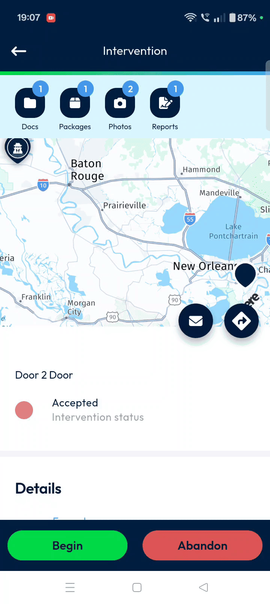

***

### 2. Funzionalità chiave e vantaggi

L'interfaccia dell'app TourSolver Mobile è progettata per una navigazione rapida e aggiornamenti in tempo reale.

**Segnaposto guida visiva:**

* **Panoramica della schermata principale dell'intervento**: Questo elemento visivo mostrerebbe la schermata principale dell'intervento, evidenziando la fila di icone di navigazione in alto, le icone di accesso rapido e la sezione dei dettagli dell'intervento. Fornirebbe una panoramica utile dell'interfaccia descritta di seguito.

#### Sezioni di navigazione (icone in alto)

Subito sotto le icone di navigazione principali, troverai una fila di icone che ti permettono di passare facilmente tra le diverse parti del tuo intervento. Ogni icona può mostrare un piccolo **badge blu** che indica il numero di elementi aggiunti a quella sezione, dandoti una rapida panoramica dei tuoi progressi.

* **Documenti**: Qui puoi **caricare e visualizzare documenti importanti** relativi al tuo intervento. Questo mantiene tutta la documentazione necessaria organizzata e accessibile.
* **Pacchi**: Questa sezione ti consente di **gestire il carico e lo scarico dei pacchi**, cruciale per le attività di ritiro.
* **Foto**: Facilmente **scattare o caricare immagini** direttamente dal campo, perfetto per catturare la prova di consegna o le condizioni del sito.
* **Annotazioni**: Usa quest'area per **inserire eventuali commenti o note** pertinenti all'intervento.
* **Rapporti**: Qui puoi **caricare il rapporto ufficiale dell'intervento**.
* **Firma**: Cattura la **conferma o firma del cliente** direttamente sul tuo dispositivo.

<figure><figcaption></figcaption></figure>

#### Strumenti di accesso rapido

Sotto le icone di navigazione principali, vedrai il **badge mappa** e due icone di accesso rapido per azioni immediate.

* **Badge mappa**: Questo badge fornisce una rapida panoramica del tuo **contesto geografico attuale**, mostrandoti esattamente dove si trova l'intervento.
* **Icona email**: Tocca questo per **inviare rapidamente aggiornamenti o contattare le parti interessate**.

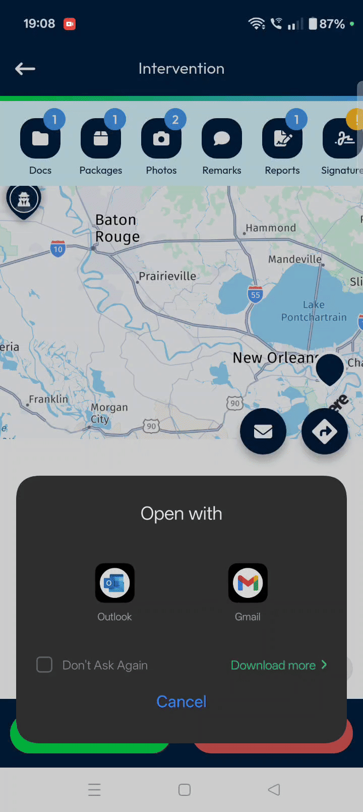

* **Pulsante di navigazione**: Posizionato accanto all'icona email, toccandolo si apre la tua **app di mappe preferita**, fornendo indicazioni di percorso istantanee verso il sito dell'intervento.

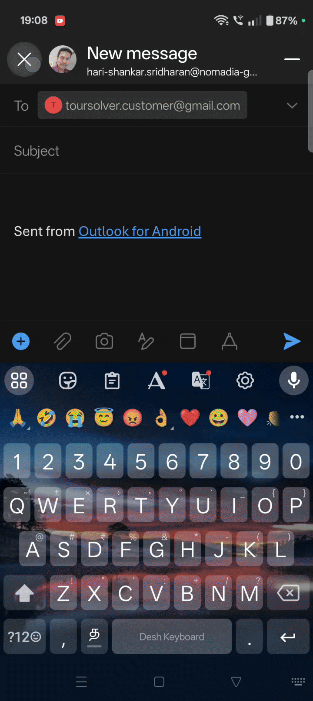

#### Dettagli intervento

Sotto queste icone troverai dettagli essenziali sul tuo intervento corrente:

* **Informazioni chiave**: Include il **titolo dell'intervento**, il suo **stato**, **ora di inizio**, **ora di fine**, e un **timer**.
* **Dettagli aggiuntivi**: Fornisce informazioni più specifiche come il **nome del sito**, **indirizzo**, **titolo dell'intervento**, **data e ora**, **orario di arrivo annunciato**, **durata stimata**, **nomi dei partecipanti**, e **riferimento esterno**.

***

### 3. Istruzioni passo dopo passo

Questa sezione ti guida attraverso le azioni più frequenti che eseguirai all'interno dell'app TourSolver Mobile.

#### Gestione dei documenti (sezione Documenti)

La sezione Documenti ti permette di gestire tutta la documentazione necessaria in formato digitale.

1. Tocca **Documenti** per caricare i documenti pertinenti.
2. Per visualizzare un documento, toccalo semplicemente per aprirlo.

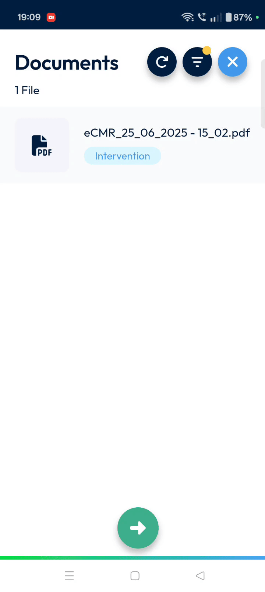

💡 **Suggerimento**: Usa l' **icona filtro** in alto per ordinare l'elenco dei documenti per intervento o sito, aiutandoti a trovare i documenti specifici più rapidamente. Dopo aver selezionato il filtro, ricordati di toccare **Applica**.

#### Scansione e gestione dei pacchi (sezione Pacchi)

Questo è cruciale per una gestione accurata dei ritiri.

<figure><figcaption></figcaption></figure>

<figure><figcaption></figcaption></figure>

1. Vedrai informazioni come: **Cliente ha ritirato data e ora**, **consegnato al cliente data e ora**, **nome dell'ordine**, e **nome e indirizzo del cliente**.
2. Puoi anche inserire eventuali **annotazioni** nella **casella dei commenti** fornita.
3. Tocca il pulsante Salva in basso per aggiornare le modifiche.

**Segnaposto guida visiva:**

* **Scansione del pacco e dettagli**]: Questo elemento visivo potrebbe mostrare l'interfaccia di scansione del pacco con un cerchio verde che indica una scansione riuscita e poi una vista dettagliata di una scheda del pacco con i suoi campi informativi. Questo chiarisce il processo di scansione e inserimento dati.

#### Cattura e caricamento foto (sezione Foto)

Documenta il tuo lavoro con immagini chiare.

1. Tocca lo **scanner** per scansionare il codice QR

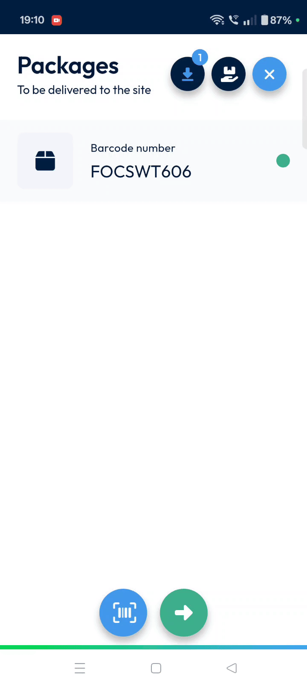

2. Una volta scansionato, il numero di codice a barre apparirà insieme a un cerchio verde accanto ad esso."

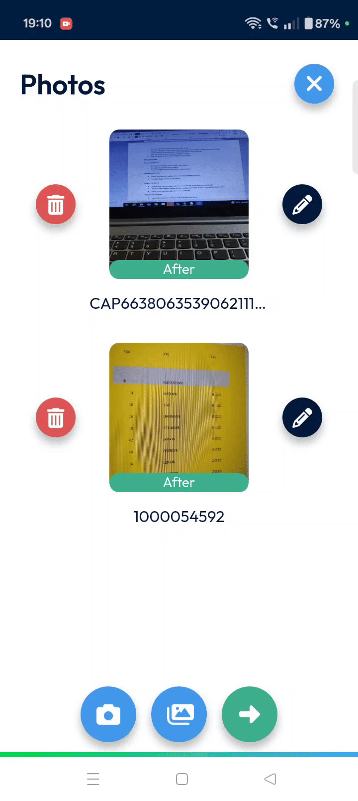

Tocca l'icona

#### Cattura e caricamento foto (sezione Foto)

1. Documenta il tuo lavoro con immagini chiare.

2. Tocca **Fotocamera** per scattare una foto

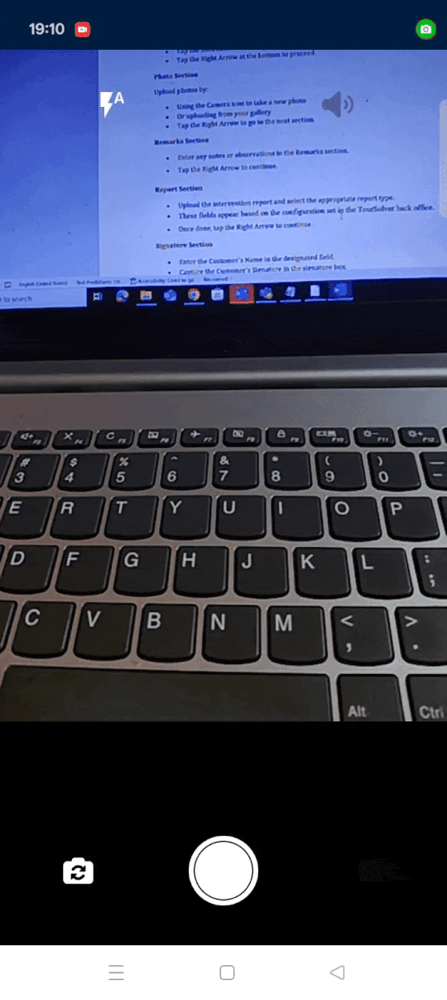

3. Seleziona il **segno di spunta** per confermare e caricare la foto."

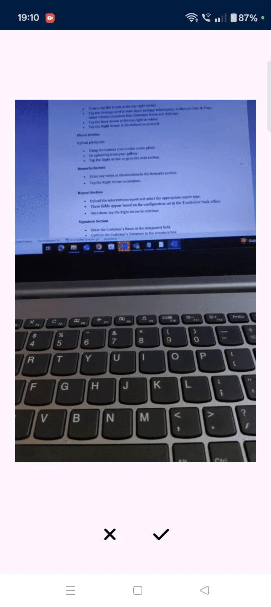

4. Tocca **icona foto per caricare un'immagine dalla galleria** Salva

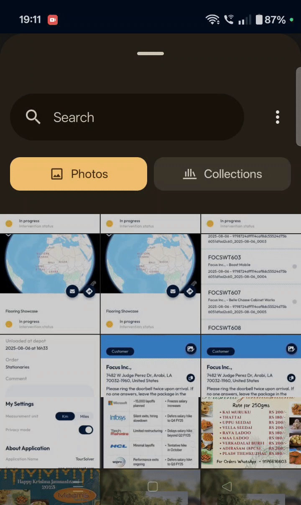

5. Tocca **per aggiornare le modifiche** Aggiunta di annotazioni generali (sezione Annotazioni)

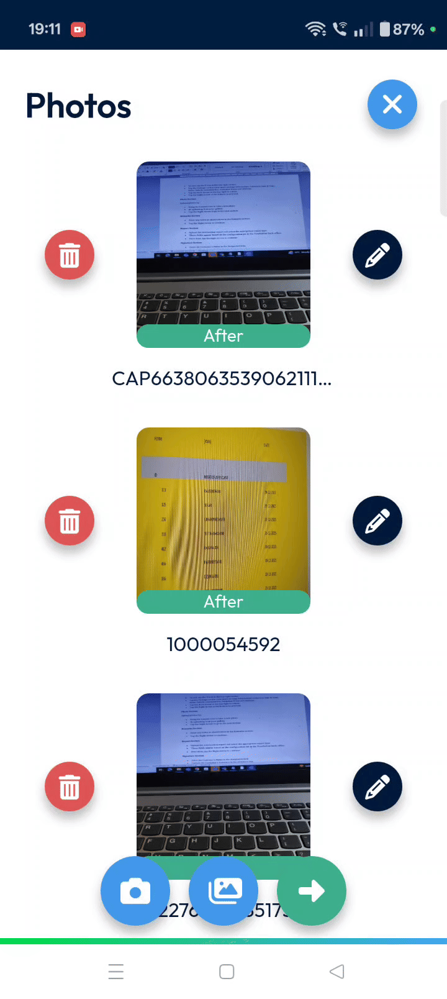

#### Fornisci contesto o note importanti per il back office.

Caricamento dei rapporti di intervento (sezione Rapporti)

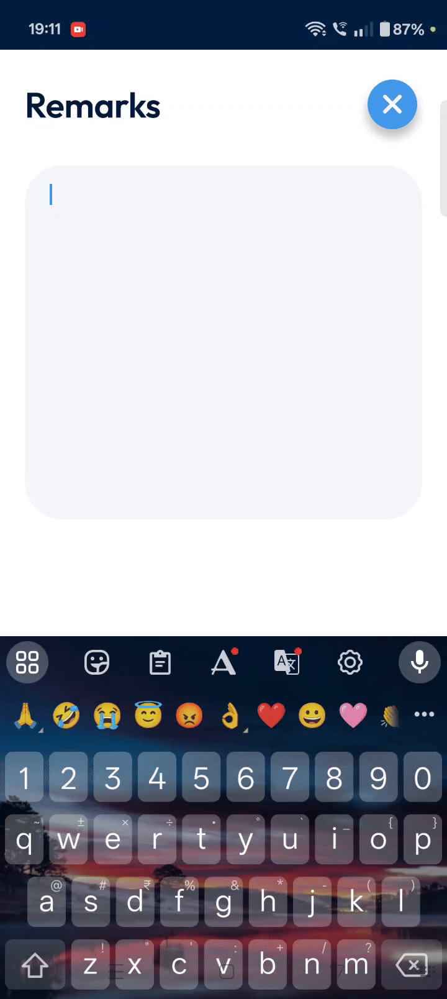

#### Completa la tua documentazione ufficiale.

Carica il rapporto dell'intervento.

1. **Seleziona il tipo di rapporto appropriato**

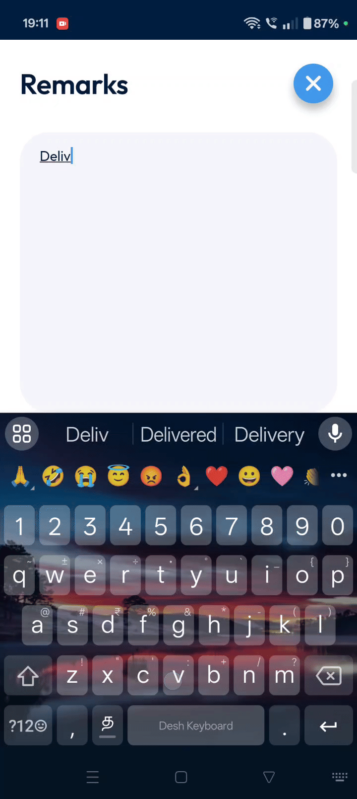

2. **Compila i dettagli necessari sotto l'opzione di rapporto pertinente. I campi visualizzati qui dipendono dalla configurazione impostata nel back office**.

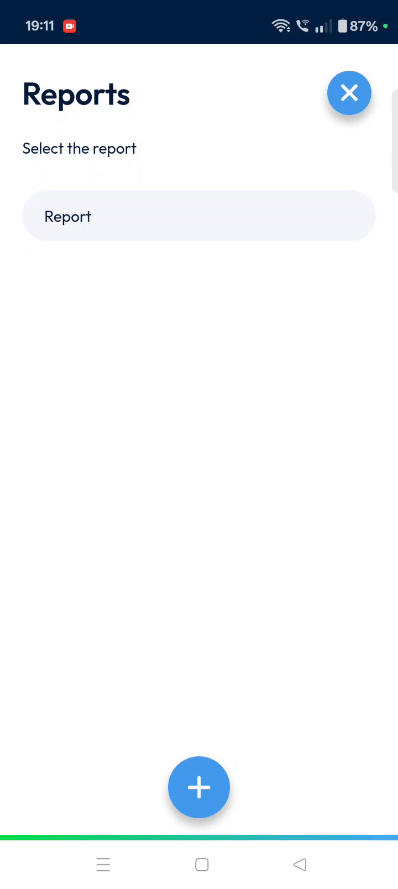

\
3\. **Cattura delle firme dei clienti (sezione Firma)**

<figure>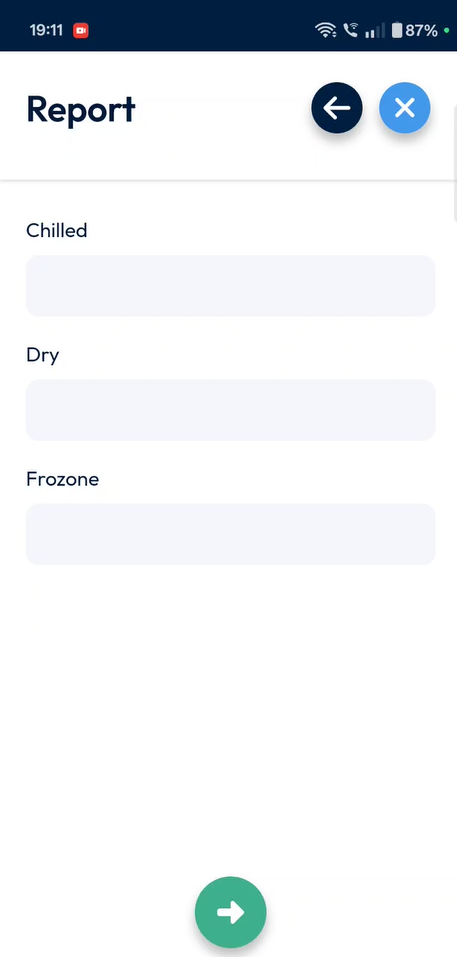<figcaption></figcaption></figure>

#### Registra facilmente l'avvenuta conferma del cliente.

Schermata/diagramma suggerito 3: Cattura della firma

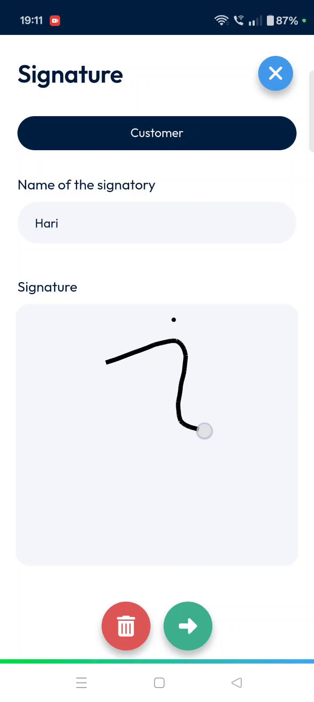

**Segnaposto guida visiva:**

* \[**]: Questo elemento visivo mostrerebbe la schermata di cattura della firma con il campo del nome del cliente e la casella della firma, dimostrando come vengono raccolte le conferme.**&#x43;ompletamento dell'intervento

#### Finalizza il tuo lavoro e sincronizzalo con il back office.

1. Una volta che tocchi

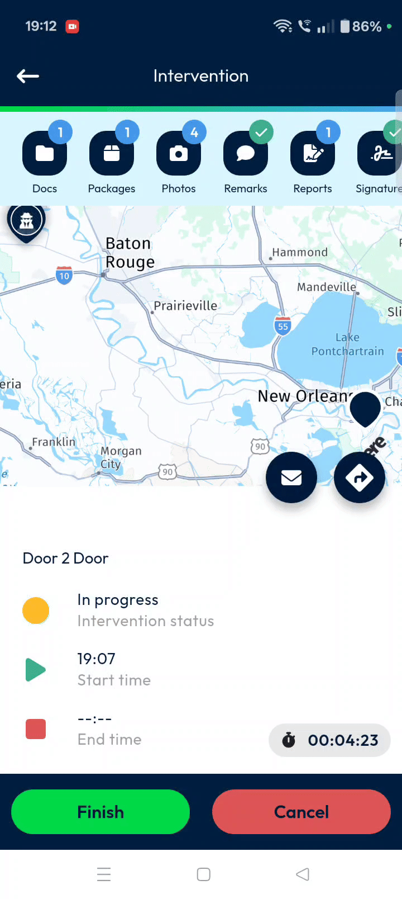

2. Un **popup di conferma** apparirà.

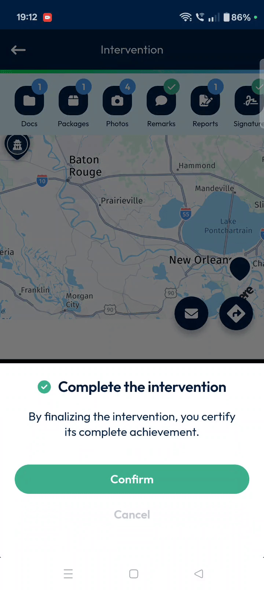

3. conferma **, lo stato verrà modificato in completato**4. Suggerimenti per la produttività

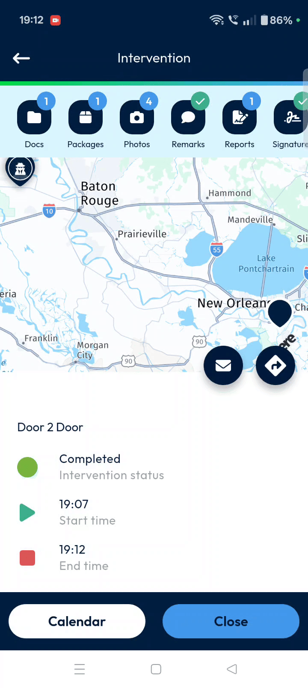

### Rimani informato con i badge

* **: Tieni d'occhio i**piccoli badge blu **su ogni icona. Ti indicano rapidamente quanti elementi (documenti, foto, pacchi) hai aggiunto a ciascuna sezione, aiutandoti a monitorare i progressi a colpo d'occhio.** Usa l'accesso rapido per la comunicazione
* **: Non dimenticare l'**&#x69;cona email **per una comunicazione rapida. Questo può farti risparmiare tempo quando devi inviare un aggiornamento veloce o contattare qualcuno direttamente dal sito dell'intervento.** Naviga in modo efficiente
* **: Il**pulsante di navigazione **è il tuo migliore alleato per raggiungere il sito successivo. Si integra con la tua app di mappe preferita, assicurandoti di avere sempre il percorso più efficiente.** I record dettagliati sono fondamentali
* **: Fai buon uso della**sezione Annotazioni **e del** all'interno dei dettagli del pacco. Note dettagliate forniscono un contesto prezioso per il tuo team e aiutano a risolvere eventuali quesiti futuri. **casella dei commenti** Verifica la configurazione del back office
* **: Ricorda che i campi del rapporto si basano sulle**configurazioni del back office di TourSolver **. Se incontri campi inattesi o hai bisogno di tipi di rapporto specifici, è una buona idea verificarlo con il team del back office.**&#x53;eguendo questa guida, sarai in grado di gestire e completare con fiducia gli interventi passo dopo passo all'interno dell'app TourSolver Mobile, rendendo il tuo lavoro più efficiente e preciso!

By following this guide, you’ll be able to confidently manage and complete interventions step-by-step within the TourSolver Mobile app, making your work more efficient and accurate!
