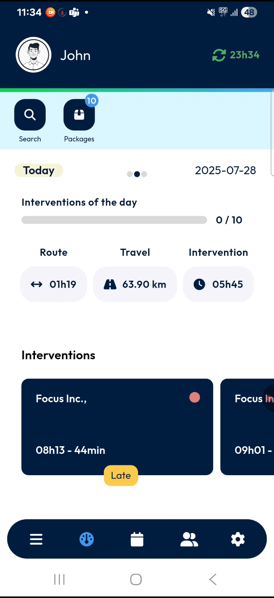
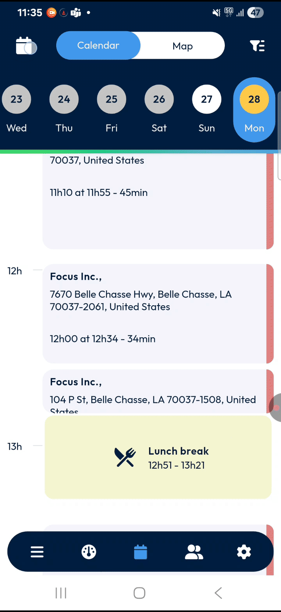
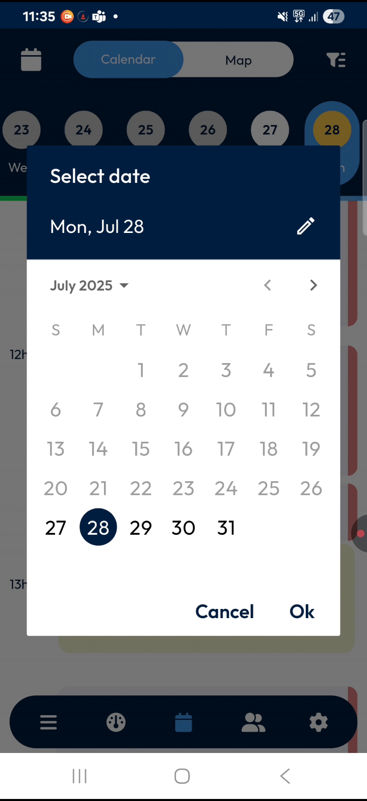
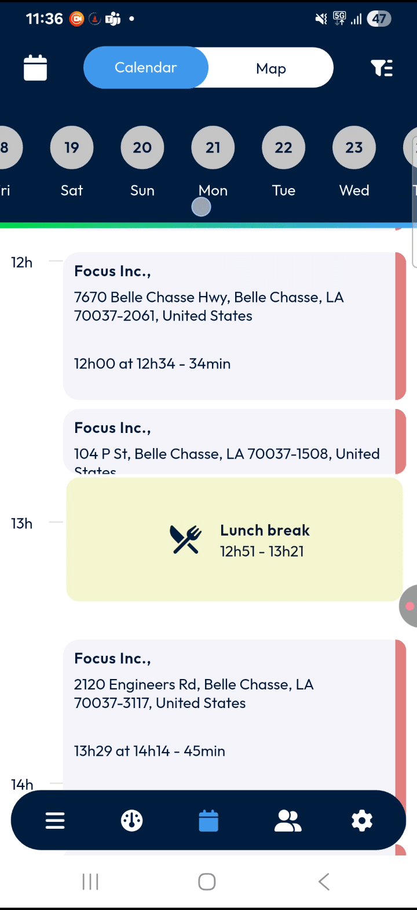
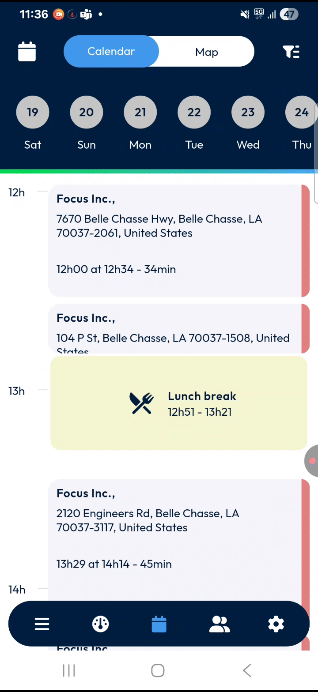
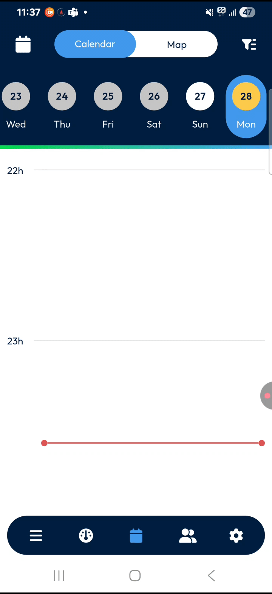
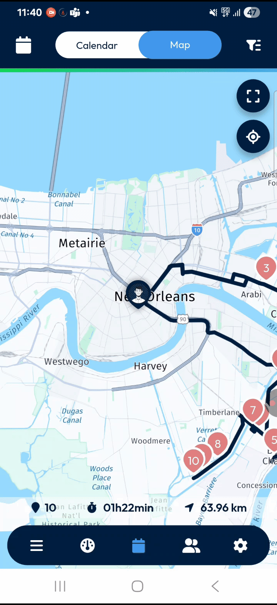
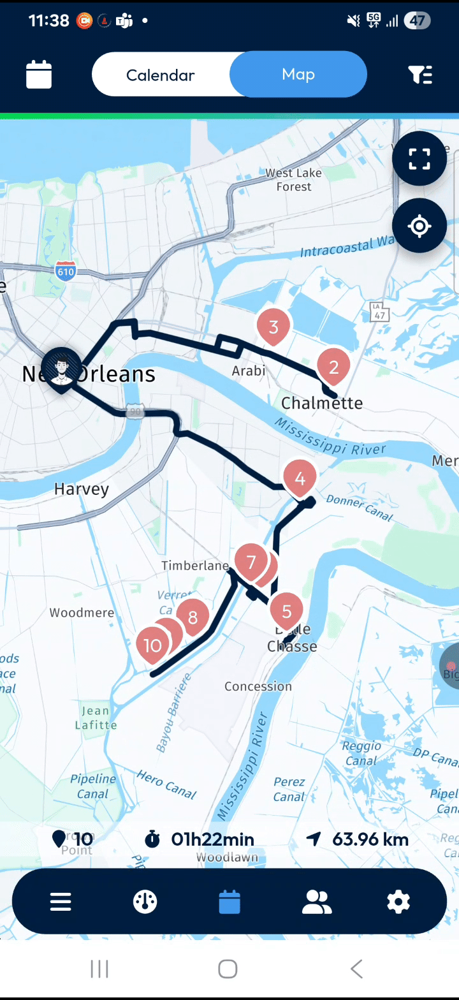

# Calendario

### 1. Iniziare&#x20;

La schermata del calendario è il tuo hub centrale per visualizzare e gestire tutte le attività pianificate, sia per oggi che per il futuro.

* **Requisiti di sistema e Installazione/Configurazione:** Le fonti fornite non specificano i requisiti di sistema o i passaggi dettagliati di installazione/configurazione per l'app TourSolver Mobile. Si prega di fare riferimento al reparto IT della vostra organizzazione o alla scheda dell'app store per queste informazioni.
* **Configurazione iniziale: Aprire il Calendario** Il tuo percorso inizia dalla dashboard principale dell'app.
  1. Cerca i pulsanti di azione principali in **fondo** dello schermo della tua app.
  2. **Tocca** il **pulsante calendario**.

### 2. Spiegazione delle funzionalità e vantaggi

Il calendario di TourSolver Mobile offre potenti funzionalità per mantenerti organizzato ed efficiente.

* **Vista Giornaliera (Predefinita):**
  * **Vantaggio:** Fornisce una panoramica immediata dell'agenda del giorno corrente, incluse le interventi sui clienti e gli eventi come pranzo o briefing.
  * **Dettagli:** Visualizza gli interventi come **schede**. Una linea rossa orizzontale mostra la timeline corrente, aiutandoti a capire a che punto sei nella giornata.
* **Selezione della data:**
  * **Vantaggio:** Ti consente di visualizzare facilmente gli interventi per una data specifica, passata (se abilitata) o futura.
  * **Dettagli:** Accessibile tramite l' **icona calendario** in alto a sinistra della schermata del calendario.
* **Vista Calendario (Schede):**
  * **Vantaggio:** Presenta una vista chiara, simile a una lista, di tutti gli interventi per una data selezionata, con dettagli su informazioni e orari del cliente.
  * **Dettagli:** Ogni intervento è visualizzato come una **scheda**, mostrando il nome del cliente, l'indirizzo, gli orari di inizio/fine e la durata. Un piccolo cerchio colorato a destra indica lo stato corrente dell'intervento. Sono inoltre elencati eventi come "pausa pranzo", "briefing", "carico" e "scarico".
* **Vista Mappa:**
  * **Vantaggio:** Offre una panoramica visiva del tuo percorso giornaliero e della posizione di ogni intervento, aiutandoti a comprendere il piano di viaggio.
  * **Dettagli:** Mostra il tuo punto di partenza e tutti gli interventi della giornata, numerati in sequenza. Un riepilogo del percorso visualizza il numero di interventi, la durata totale e la distanza da percorrere. Puoi anche vedere le schede degli interventi affiancate alla mappa nella modalità a schermo intero.
* **Filtri e Opzioni di Visualizzazione:**
  * **Vantaggio:** Personalizza il modo in cui visualizzi il tuo programma, permettendoti di passare tra vista giorno, settimana o elenco, e accedere ad azioni importanti.
  * **Dettagli:** Accessibile tramite l' **pulsante filtro** in alto a destra dello schermo.
* **Legenda colori stato intervento:**
  * **Vantaggio:** Comprendi rapidamente lo stato di ogni intervento a colpo d'occhio in base al colore.
  * **Dettagli:** La legenda dei colori è accessibile toccando il **pulsante filtro**.
    * **Rosso:** Stato in attesa.
    * **Rosa chiaro:** Stato accettato (questo è indicato anche se una scheda dice "la tua prossima visita" come tua prossima azione).
    * **Giallo:** In corso.
    * **Verde:** Completato.
    * **Viola scuro:** Rifiutato.
    * **Viola chiaro:** Abbandonato.

***

### 3. Istruzioni passo passo

Ecco come eseguire le azioni principali all'interno del Calendario di TourSolver Mobile.

**3.1. Cambiare la data di visualizzazione** Per visualizzare il tuo programma in un giorno diverso:

1. Dalla schermata del calendario, tocca il **icona calendario** in **alto a sinistra**.

2. Il mese corrente sarà visualizzato con la data odierna evidenziata.
3. Hai diverse opzioni per scegliere un'altra data:

4\. Una volta scelta la data, tocca **OK** per confermare la selezione o **Annulla** per chiudere il pop-up senza cambiare la data.

**3.2. Passare tra Vista Calendario e Vista Mappa** Puoi scegliere come visualizzare i tuoi interventi:

1. Al centro in alto dello schermo, accanto all'icona del calendario, vedrai due icone di visualizzazione.
2. **Tocca** tocca l'icona corrispondente per cambiare:

**3.3. Utilizzare filtri e opzioni di visualizzazione** Per affinare la tua vista o accedere alle azioni:

1. Tocca il **pulsante filtro** in **in alto a destra** dello schermo.

2. Da questo menu puoi passare tra Settimana, Giorno e Elenco

**3.4. Visualizzare i dettagli dell'intervento nella Vista a Schede**

1. Una volta impostati i filtri, scorri verso il basso per vedere tutti gli interventi per la data selezionata.
2. Ogni intervento appare come una **scheda**.
3. Sulla singola scheda vedrai:
   * Il **nome** del cliente **e**.
   * l'indirizzo **Orari di inizio e fine dell'intervento** del cliente **durata**.
   * Un piccolo **cerchio colorato** che indica lo stato corrente (consulta la Legenda Colori nel menu filtri).
     * 💡 **Suggerimento:** Se una scheda dice "**La tua prossima visita**," indica la tua azione immediata successiva.
4. Per vedere più dettagli e avviare un'attività, **tocca** una scheda intervento.
   * \[Screenshot: Esempio di scheda intervento con dettagli evidenziati]

**3.5. Esplorare la Vista Mappa** Per una panoramica visiva del tuo percorso:

1. Tocca il **icona vista mappa** al centro in alto dello schermo.
2. La mappa mostrerà:
   * La tua **posizione di partenza**.
   * Ogni intervento del giorno, **numerato in ordine**.
   * Un **riepilogo del percorso** inclusi il numero di interventi, la durata totale e la distanza da percorrere.
   * La tua **percorso tracciato** sulla mappa.
3. **Vista mappa a schermo intero:**

**3.6. Tornare alla schermata principale del Calendario** Puoi sempre tornare alla schermata principale del calendario toccando la **freccia indietro** in **alto a sinistra**.

***

### 4. Suggerimenti per la produttività

💡 La schermata del calendario è progettata per aiutarti a vedere e gestire rapidamente gli interventi per qualsiasi data, oggi o in futuro.

* **Rimani aggiornato:** Usa regolarmente la funzione **"Aggiorna la mia agenda"** (presente sotto il **pulsante filtro > Azioni**) per assicurarti che il tuo calendario rifletta le ultime modifiche dal tuo pianificatore. Questo è fondamentale per una programmazione accurata.
* **Ricerca rapida:** Se hai bisogno di trovare un intervento specifico, non scorrere all'infinito! Usa lo strumento **"Cerca un intervento"** (anch'esso sotto **pulsante filtro > Azioni**) per individuarlo rapidamente digitando un nome, un numero, una data o un indirizzo.
* **Pianificazione visiva:** Sfrutta la **Vista Mappa** per comprendere il tuo percorso giornaliero e la distribuzione geografica degli interventi. Questo può aiutarti a prevedere i tempi di spostamento e ottimizzare la sequenza delle visite.
* **Stato a colpo d'occhio:** Familiarizzati con la **legenda dei colori** per gli stati degli interventi. Questo permette una rapida identificazione degli stati accettati, in corso, completati o altri senza dover aprire ogni singola scheda.
