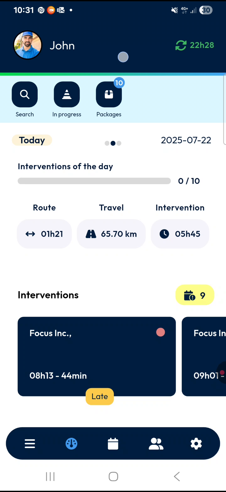
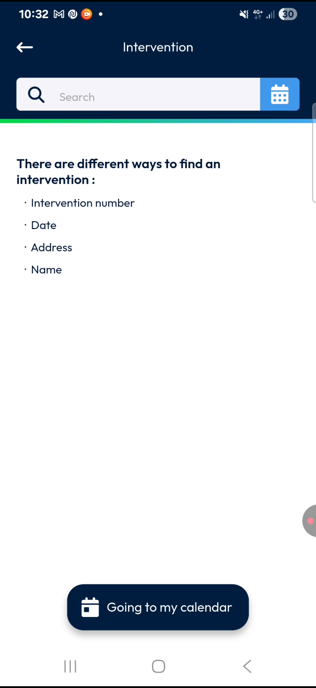
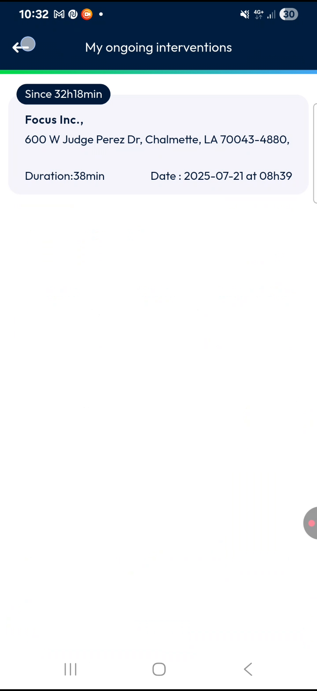
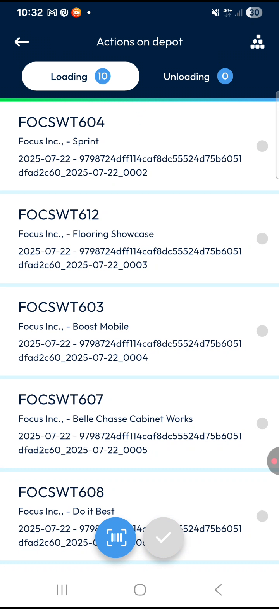
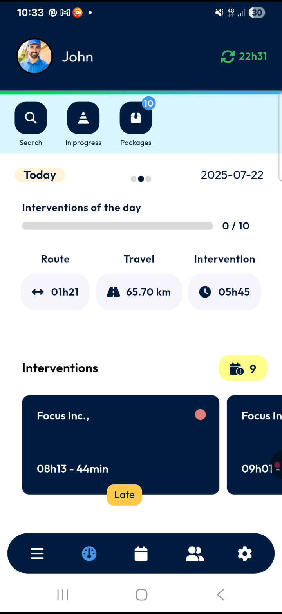
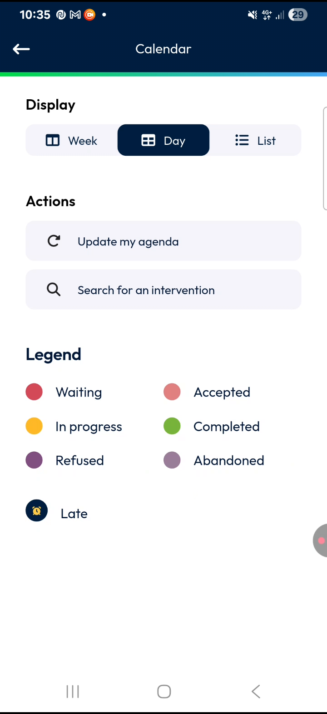
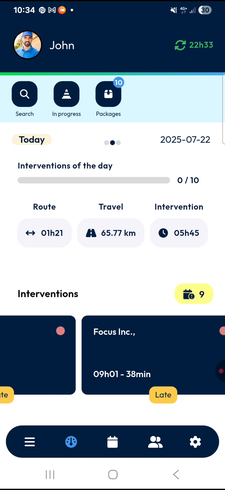

# Cruscotto

### 1. Per iniziare

Al momento dell'accesso riuscito, vedrai immediatamente il tuo **Cruscotto** schermata. Questa schermata è progettata per darti una rapida panoramica delle attività della giornata.

* **Vista iniziale dopo l'accesso**: Quando accedi per la prima volta, il tuo cruscotto mostrerà il tuo programma e i tuoi progressi. Ad esempio, la **Barra di avanzamento** potrebbe mostrare "0 su 10", il che significa che hai 10 interventi programmati per oggi e nessuno è ancora stato completato. Questa barra si aggiornerà automaticamente man mano che completi i compiti durante la giornata.

### 2. Spiegazione delle funzionalità con vantaggi

Il cruscotto di TourSolver Mobile è pieno di funzionalità utili pensate per aiutarti a gestire la giornata in modo efficace.

* **Sezione superiore: il tuo profilo e lo stato dei dati**
  * **Avatar e nome**: Nel **angolo in alto a sinistra**, vedrai la tua **foto profilo (avatar)** e il tuo **nome** visualizzato accanto ad essa.
    * **Vantaggio**: Questo conferma che sei connesso e aiuta a personalizzare la tua esperienza.

* **Ora di sincronizzazione**: Nel **angolo in alto a destra**, puoi vedere l' **ultima volta in cui l'app si è sincronizzata con successo con il back office**.
  * **Vantaggio**: Questo ti indica quanto sono aggiornati i tuoi dati, assicurandoti di lavorare con le informazioni più recenti.

* **Pulsanti di azione rapida: i tuoi strumenti quotidiani** Poco sotto la sezione superiore, questi pulsanti forniscono accesso rapido a funzioni importanti:
  * **Cerca**: Questo pulsante ti permette di **trovare rapidamente qualsiasi intervento** inserendo il nome del cliente, un numero, una data o un indirizzo.
    * **Vantaggio**: Fa risparmiare tempo aiutandoti a localizzare compiti specifici senza dover scorrere l'intera agenda.

* **Interventi in corso**: Questo pulsante visualizza una **lista dei tuoi interventi attualmente in corso**.
  * **Vantaggio**: Ti aiuta a concentrarti sui compiti su cui stai lavorando attivamente.
    * 💡 **Suggerimento**: Questo pulsante appare solo se hai interventi attualmente contrassegnati come "in corso".

* **Carica pacchi**: Questo pulsante viene utilizzato per **caricare tutti i pacchi di consegna sul tuo camion** prima di iniziare il tuo percorso giornaliero.
  * **Vantaggio**: Garantisce che tu abbia tutti gli articoli necessari pronti prima di iniziare i compiti quotidiani.

* **Carosello dell'agenda: il tuo programma a colpo d'occhio** Sotto i pulsanti di azione rapida, troverai un **carosello dell'agenda**.
  * Questo mostra il tuo **programma per oggi**.
  * Puoi **scorri verso destra** per vedere l'agenda di ieri o **scorri verso sinistra** per vedere l'agenda di domani.
  * La **giorno** (ad es., "oggi", "ieri" o "domani") è visualizzato sul **lato sinistro** del carosello.
  * La **data effettiva** per il giorno selezionato è mostrata sul **lato destro**.
  * **Vantaggio**: Fornisce una vista chiara e flessibile del tuo programma per i giorni correnti, passati o futuri.

* **Barra di avanzamento: monitora il completamento giornaliero** Sotto il carosello dell'agenda, la **barra di avanzamento** rappresenta visivamente **quanti interventi hai completato oggi**.
  * Man mano che completi gli interventi, questa barra si aggiorna automaticamente in tempo reale.
  * **Vantaggio**: Offre un immediato aggiornamento visivo sui tuoi progressi, aiutandoti a rimanere motivato e in carreggiata.

* **Riepilogo percorso: panoramica del carico di lavoro** Poco sotto la barra di avanzamento, il **riepilogo del percorso** fornisce tre informazioni chiave per la tua giornata:
  * **Percorso**pulsante di navigazione **distanza totale** che percorrerai oggi.
  * **Viaggio**pulsante di navigazione **chilometri totali pianificati** per la giornata.
  * **l'indirizzo**pulsante di navigazione **durata complessiva degli interventi** pianificati per la giornata.
  * **Vantaggio**: Ti dà una rapida panoramica essenziale del carico di lavoro quotidiano, aiutandoti a comprendere l'entità dei tuoi compiti.

* **Sezione interventi: dettagli dei tuoi compiti** Scorrendo verso il basso, entrerai nella **sezione interventi** dove tutte le attività della giornata sono visualizzate come **schede individuali**.
  * Puoi **scorri queste schede da destra a sinistra** per sfogliare tutti gli interventi programmati.
  * A destra dell'etichetta "Intervento", vedrai un conteggio di **quanti interventi sono in ritardo oggi**. Ad esempio, potrebbe mostrare "nove interventi sono in ritardo oggi".
  * Ogni **scheda intervento** mostra dettagli importanti:
    * La **nome del cliente**.
    * La **ora programmata** per quell'intervento.
    * La **durata stimata** dell'intervento.
  * **Cerchio colorato**: Un piccolo **cerchio colorato** nell'angolo in alto a destra di ogni scheda rappresenta lo **stato attuale dell'intervento** (ad es., completato, accettato).
    * **Vantaggio**: Fornisce un rapido segnale visivo sullo stato del compito.
    * 💡 **Suggerimento**: Puoi trovare la **legenda di questi colori** nella **menu del calendario** sotto la **opzione filtro**.

* **Bandiera ritardo**: Se un compito è in ritardo, vedrai una piccola **bandiera rettangolare gialla "in ritardo"** nella parte inferiore centrale della scheda.
  * **Vantaggio**: Evidenzia immediatamente i compiti in scadenza, aiutandoti a dare loro priorità.

* **Vantaggio**: Offre una vista completa e dettagliata di ogni compito, rendendo facile vedere tutte le informazioni necessarie a colpo d'occhio.

* **Pulsanti di navigazione principali: muoversi nell'app** Nella parte inferiore del cruscotto, troverai i **pulsanti del menu principale**. Questi ti permettono di passare facilmente tra le diverse schermate dell'app, inclusi:
  * **Menu**
  * **Cruscotto**
  * **Calendario**
  * **Contatti e clienti**
  * **Impostazioni**
  * **Vantaggio**: Fornisce una navigazione senza soluzione di continuità all'interno dell'applicazione TourSolver Mobile.

### 3. Istruzioni passo dopo passo

Ecco come interagire con alcune funzionalità chiave del tuo cruscotto:

* **Rivedere il programma per giorni diversi**:
  1. Individua l'icona **Carosello dell'agenda** sotto i pulsanti di azione rapida.
  2. Per vedere **il programma di ieri**, **scorri il carosello verso destra**.
  3. Per vedere **il programma di domani**, **scorri il carosello verso sinistra**.
  4. Il giorno e la data visualizzati sul carosello si aggiorneranno per riflettere la tua selezione.

* **Sfogliare i tuoi interventi**:
  1. Scorri verso il basso fino alla **sezione Interventi**.
  2. Vedrai i tuoi interventi programmati visualizzati come schede individuali.
  3. Per visualizzare tutti i tuoi interventi per la giornata, **scorri queste schede da destra a sinistra**.

* **Trovare rapidamente uno specifico intervento**:
  1. Individua l'icona **Pulsante Cerca** poco sotto le informazioni del tuo profilo.
  2. **Tocca il pulsante Cerca**.
  3. **Inserisci il nome, il numero, la data o l'indirizzo** dell'intervento che stai cercando.
  4. L'app mostrerà i risultati corrispondenti, aiutandoti a saltare rapidamente al compito desiderato.

### Rimani informato con i badge

* 💡 **Rimani sincronizzato**: Controlla regolarmente l' **Ora di sincronizzazione** nell'angolo in alto a destra. Una sincronizzazione recente significa che i tuoi dati sono aggiornati, il che è fondamentale per gestire efficacemente i tuoi compiti.
* 💡 **Pianifica in anticipo o rivedi il passato**: Usa il **Carosello dell'agenda** per scorrere rapidamente tra oggi, ieri e domani. Questo ti aiuta a pianificare la giornata successiva o a rivedere i compiti completati.
* 💡 **Dai priorità ai compiti in ritardo**: Tieni sempre d'occhio il **conteggio "in ritardo"** nella sezione interventi e la **bandiera gialla "in ritardo"** sulle singole schede intervento. Affrontarli prontamente può aiutare a mantenere il tuo programma in carreggiata.
* 💡 **Comprendi lo stato a colpo d'occhio**: Familiarizza con i **cerchi colorati** sulle schede intervento e i loro significati controllando la **legenda nel menu Calendario sotto l'opzione filtro**. Questo permette una rapida valutazione visiva dello stato di ciascun compito.
* 💡 **Sfrutta le azioni rapide**: Usa le **Cerca**, **Macchine in corso**, e **Carica pacchi** pulsanti. Sono progettati per l'accesso rapido alle funzioni essenziali e possono aumentare significativamente la tua efficienza.

Il cruscotto è il tuo strumento definitivo per gestire i compiti quotidiani con fiducia ed efficienza. Se hai bisogno di informazioni più dettagliate su una sezione specifica, consulta le altre guide dedicate.
