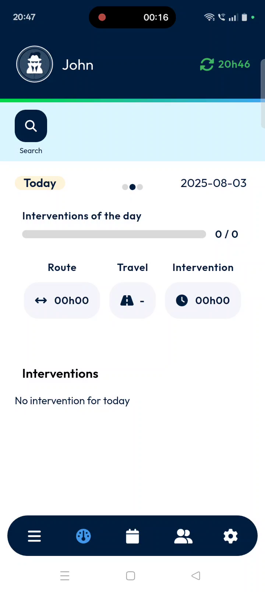
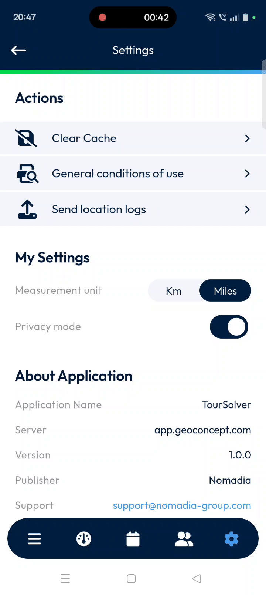
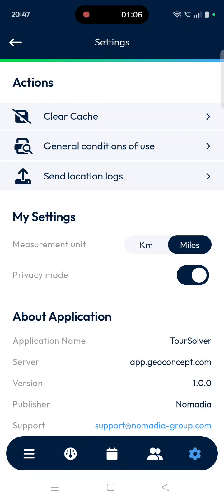
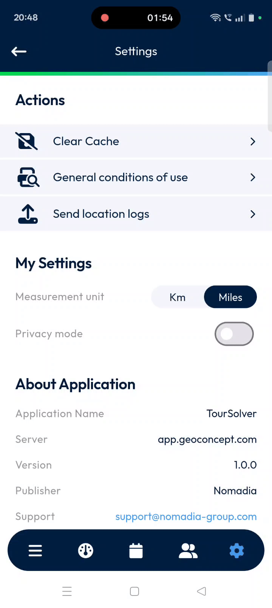

# Impostazioni

### 1. Per cominciare

Sebbene le fonti fornite non specifichino i requisiti di sistema esatti per l'app TourSolver Mobile né i passaggi iniziali di installazione, questa sezione ti guiderà nell'accesso e nell'esecuzione delle configurazioni iniziali essenziali all'interno delle impostazioni dell'app.

**1. Accesso alla schermata Impostazioni** Per accedere alle impostazioni:

1. **Avvia l'app TourSolver Mobile**.
2. Individua l'icona **a forma di ingranaggio** nella barra di navigazione inferiore.
3. Tocca il **a forma di ingranaggio**.

4. Ora sarai sulla **schermata Impostazioni**. Qui troverai tre sezioni principali: **Azioni**, **Le mie impostazioni**, e **Informazioni sull'applicazione**.
   * _Immagina una schermata qui che mostri la schermata principale Impostazioni con le tre sezioni chiaramente etichettate._

**2. Configurazione iniziale (primi passaggi importanti)**

* **Imposta l'unità di misura preferita**:
  1. Nella schermata Impostazioni, vai alla **Le mie impostazioni** sezione.
  2. Tocca l'opzione "unità di misura".
  3. Scegli l'unità preferita selezionando **Chilometri** o **Miglia** in base alla tua regione o preferenza.

* **Abilita la Modalità Privacy per il controllo dei dati**:
  1. Nella schermata Impostazioni, sempre sotto **Le mie impostazioni**, trova l'opzione "Abilita modalità privacy".
  2. **Attiva** questa opzione per **limitare la raccolta dei dati dell'app**.
  3. 💡 **Suggerimento**: Abilitare la modalità privacy è un ottimo modo per assicurarti che le tue informazioni personali siano gestite in conformità con **gli standard GDPR**, dandoti il pieno controllo su come i tuoi dati vengono condivisi.

***

### 2. Comprendere le funzionalità dell'app (sezioni Impostazioni)

La scheda Impostazioni organizza funzionalità preziose in tre sezioni facili da comprendere:

* **Azioni**: Questa sezione offre opzioni per gestire le prestazioni dell'app e agevolare il supporto.
  * **Svuota cache**: Questa opzione aiuta l'app a funzionare senza intoppi rimuovendo i file temporanei.
    * **Vantaggio**: Ottimizza le prestazioni e aggiorna contenuti obsoleti, assicurandoti di visualizzare sempre le informazioni più aggiornate.
  * **Condizioni generali d'uso**: Qui puoi accedere e leggere gli avvisi legali ufficiali, i termini e le definizioni applicabili all'app.
    * **Vantaggio**: Rimani informato sui tuoi diritti e responsabilità quando utilizzi l'app.
  * **Invia log posizione**: Questa funzione ti permette di inviare in modo sicuro la cronologia delle tue posizioni direttamente al team di supporto.
    * **Vantaggio**: Essenziale per la risoluzione dei problemi o per scopi diagnostici se incontri problemi che richiedono assistenza tecnica.
* **Le mie impostazioni**: Questa sezione ti consente di personalizzare l'esperienza dell'app.
  * **Unità di misura**: Scegli l'unità preferita per le misurazioni delle distanze.
    * **Vantaggio**: Personalizza l'app per visualizzare le distanze in **chilometri** o **miglia**, rendendola più comoda e familiare per te.
  * **Modalità Privacy**: Controlla come i tuoi dati personali vengono raccolti dall'app.
    * **Vantaggio**: Abilitando questa opzione, allinei il trattamento dei dati dell'app con **gli standard GDPR**, assicurandoti di avere il pieno controllo sulle tue informazioni personali e su come vengono condivise.
* **Informazioni sull'applicazione**: Questa sezione fornisce informazioni tecniche essenziali sull'app TourSolver Mobile.
  * **Nome dell'applicazione**: L'app si chiama **TourSolver**.
  * **Server**: Sincronizza i dati utilizzando il server `apps.concept.com`.
  * **Versione**: Visualizza la versione corrente installata, ad esempio, `1.0.0`.
  * **Editore**: L'app è sviluppata e pubblicata da **Nomadia**, un leader riconosciuto nelle soluzioni di mobilità intelligente.
  * **Supporto**: Fornisce l'indirizzo email per il supporto: `support@nomadiagroup.com` per qualsiasi assistenza.
  * **Sito web**: Fornisce l'indirizzo del sito ufficiale: `www.nomadiagroup.com` per ulteriori informazioni.
    * **Vantaggio**: Trova rapidamente dettagli importanti sull'app, comprese le informazioni di contatto per il supporto, utili per la risoluzione dei problemi o per richieste di informazioni.

***

### 3. Attività comuni nelle Impostazioni

Ecco istruzioni passo-passo per azioni comuni che potresti voler eseguire nella scheda Impostazioni:

* **Come svuotare la cache dell'app**:
  1. Dalla schermata Impostazioni, tocca **Svuota cache** sotto la **Azioni** sezione.
  2. Apparirà un pop-up di conferma che chiede "Sei sicuro di voler svuotare la cache della tua applicazione?"

* **Come leggere le Condizioni generali d'uso**:
  1. Nella schermata Impostazioni, tocca **Condizioni generali d'uso** sotto la **Azioni** sezione.
  2. Verrai portato a una nuova schermata dove potrai leggere gli avvisi legali completi, i termini e le definizioni.

* **Come inviare i log di posizione al supporto**:
  1. Dalla schermata Impostazioni, tocca **Invia log posizione** sotto la **Azioni** sezione.
  2. Dopo aver toccato, apparirà un messaggio di conferma che indica che "i log sono stati inviati con successo."

* **Come cambiare l'unità di misura**:
  1. Dalla schermata Impostazioni, individua il **Le mie impostazioni** sezione.
  2. Tocca l'opzione per **unità di misura**.
  3. Scegli l'unità preferita selezionando **Chilometri** o **Miglia** in base alla tua regione o preferenza.

* **Come abilitare la Modalità Privacy**:
  1. Dalla schermata Impostazioni, individua il **Le mie impostazioni** sezione.
  2. Trova l'opzione "Abilita modalità privacy."
  3. **Attiva** l'interruttore accanto a questa opzione per attivarlo **su** (per limitare la raccolta dei dati) o **off**.

### 4. Suggerimenti per la produttività&#x20;

* **Pulizia regolare della cache**: Fai l'abitudine di **Svuota cache** periodicamente. Questo mantiene l'app veloce e reattiva, prevenendo rallentamenti causati dall'accumulo di file temporanei.
* **Controllo dei dati**: Approfitta della **Modalità Privacy**. Se la privacy dei dati è una preoccupazione, abilitare questa funzione ti dà un maggiore controllo su come le tue informazioni vengono gestite, in linea con gli standard internazionali sulla privacy.
* **Accesso rapido al supporto**: Se riscontri problemi tecnici, ricorda che la funzione **Invia log posizione** può essere un modo rapido per fornire informazioni diagnostiche essenziali al team di supporto. Puoi anche trovare l' **indirizzo email del supporto** del cliente **sito web** sotto "Informazioni sull'applicazione" per assistenza diretta.
* **Rimani informato**: Rivedi periodicamente le **Condizioni generali d'uso** per rimanere aggiornato su eventuali avvisi legali o termini che regolano l'uso dell'app.
