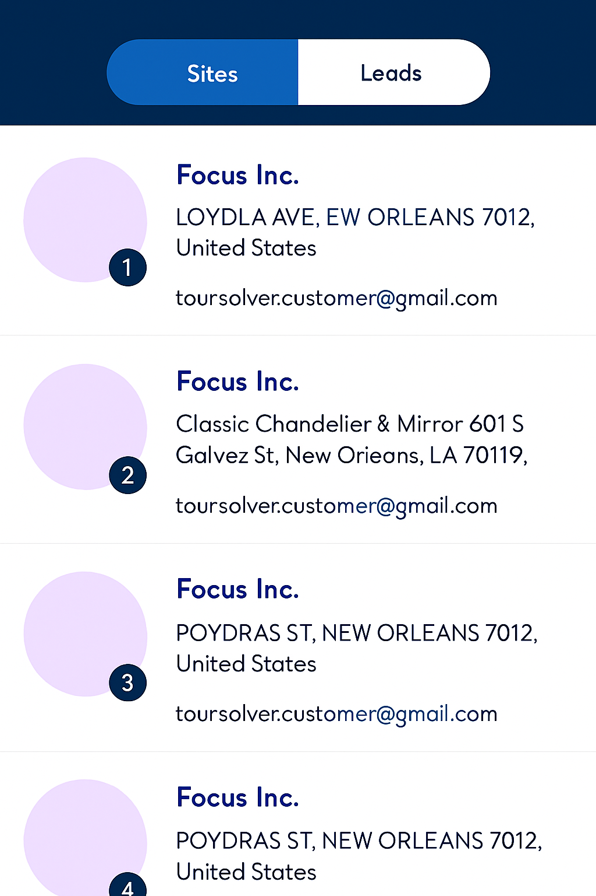

# Siti

### 1. Per cominciare

L'applicazione TourSolver Mobile **Siti e Lead** semplifica la gestione delle informazioni sui clienti e l'ottimizzazione delle tue attività sul campo.

* **Requisiti di sistema:** Le fonti fornite non specificano i requisiti di sistema per l'applicazione TourSolver Mobile.
* **Passaggi di installazione/configurazione:** Le fonti fornite non includono i passaggi per installare o configurare l'applicazione TourSolver Mobile.
* **Configurazione iniziale:** Le fonti indicano che **i lead sono sedi secondarie del cliente già memorizzate nel database**. Possono avere record assegnati o non assegnati al tuo percorso attuale. L'applicazione ottimizza automaticamente i percorsi, quindi la distanza mostrata è solo a scopo informativo e non per ulteriori ottimizzazioni.

### 2. Spiegazione delle funzionalità con vantaggi

La **Siti e Lead** funzionalità offre un modo solido per gestire le interazioni con i clienti:

* **Siti del cliente**: Queste sono le sedi dei clienti assegnate al percorso corrente
* **Schede ordine dettagliate**: Ogni scheda ordine cliente mostra informazioni essenziali a colpo d'occhio, inclusi il nome del cliente, l'indirizzo, l'ID email, il numero di telefono e la posizione attuale.
* **Aggiornamenti in tempo reale**: Quando tocchi una scheda cliente, puoi accedere a informazioni dettagliate che includono aggiornamenti in tempo reale sull'ordine del cliente, la posizione e qualsiasi preferenza specifica come le istruzioni di consegna. Vedrai anche la distanza stimata, il tempo di viaggio stimato, il territorio del lead, i contatti e i documenti collegati.
* **Percorsi ottimizzati**: L'applicazione include percorsi già ottimizzati, il che significa che la distanza mostrata è puramente informativa.
* **Operazioni sul campo efficienti**: Funzionalità come filtri intelligenti e navigazione integrata sono progettate per supportare le tue attività quotidiane, aiutandoti a rimanere organizzato, efficiente e ben informato.

### 3. Istruzioni passo dopo passo

Questa sezione ti guiderà attraverso le attività più frequenti che eseguirai all'interno della **Siti e Lead** funzionalità.

#### Accesso a Siti e Lead

Per iniziare, devi accedere alla sezione principale Siti e Lead dalla tua dashboard.

1. Dalla dashboard, **tocca** su **Siti e Lead** il pulsante situato nella parte inferiore dello schermo, accanto alla scheda Calendario.
2. Successivamente, **tocca** l'opzione S**iti** che si trova prima della scheda Lead.

#### Visualizzazione e interazione con le schede cliente

Ogni ordine cliente è presentato come una scheda con informazioni chiave.

1. Per visualizzare informazioni dettagliate, **tocca direttamente qualsiasi scheda cliente**.

#### Aggiunta di foto del cliente

Puoi aggiungere foto al record di un cliente, sia scattando una nuova foto sia caricandone una dalla tua galleria.

1. **Tocca** l'icona **della foto** sul lato destro dello schermo.
2. Per scattare una nuova foto:
   * **Tocca** l'icona **icona della fotocamera** in basso.
   * Scatta la foto.
   * **Tocca** l'icona **segno di spunta** in basso per caricare l'immagine.
   * **Tocca** l'icona **icona Salva** in basso per aggiornare le modifiche.
3. Per caricare dalla galleria:
   * **Tocca** l'icona **della foto** accanto all'icona della fotocamera.
   * **Seleziona una foto** dalla tua galleria.
   * **Tocca Fatto** per caricare l'immagine.

#### Spostamento di un sito cliente

Se le coordinate di un cliente devono essere aggiornate alla tua posizione attuale, puoi farlo facilmente.

1. **Tocca** l'icona **menu a tre punti** nell'angolo in alto a destra dello schermo.
2. Dalle opzioni a comparsa, **seleziona Riposiziona**.
3. Apparirà un messaggio di conferma. **Tocca Conferma** per procedere.

#### Copia dei dettagli del cliente

Puoi copiare rapidamente i dettagli del cliente per condividerli facilmente.

1. **Tocca** l'icona **pulsante copia** situato appena sotto l'icona della foto.

#### Invio dei dettagli del cliente a un altro dispositivo

Puoi condividere i dettagli del cliente con un'altra persona utilizzando un codice QR.

1. Dopo aver copiato i dettagli del cliente, **tocca Invia al dispositivo**.
2. **Tocca Usa codice QR**.

#### Navigazione tramite mappe

L'applicazione si integra con app di navigazione come Google Maps per indicazioni di guida senza interruzioni.

1. **Tocca** su **pulsante di navigazione** situato sotto il pulsante copia.
2. L'app offrirà le opzioni di navigazione disponibili, come **Google Maps**.
3. **Seleziona Google Maps**.

#### Collegamento di documenti

Puoi collegare documenti importanti al record di un cliente, sia scattando una foto del documento sia caricandolo da una cartella.

1. **Tocca** l'icona **icona documento** accanto a "documenti collegati".
2. Per scattare una foto di un documento:
   * **Tocca** l'icona **icona della fotocamera** in basso.
   * Scatta la foto.
   * **Tocca** l'icona **segno di spunta** in basso per caricare l'immagine.
   * **Tocca** l'icona **icona Salva** in basso per aggiornare le modifiche.
3. Per caricare un documento da una cartella:
   * **Tocca** l'icona **della foto** accanto all'icona della fotocamera.
   * **Seleziona Documenti**.
   * **Tocca Conferma** per procedere.
   * **Seleziona un documento** dalla cartella.

#### Passare tra visualizzazione elenco e mappa

Puoi passare tra due visualizzazioni per adattarle al meglio alle tue esigenze:

1. Per vedere visivamente i siti dei clienti su una mappa, **tocca l'icona della mappa**.
   * **Risultato**: L'app mostra le posizioni dei clienti su una mappa.
2. Per visualizzare un riepilogo dettagliato delle informazioni del cliente, **tocca l'icona dell'elenco**.

#### Ricerca dei clienti

Trova rapidamente voci cliente specifiche utilizzando la barra di ricerca.

1. **Tocca** l'icona **icona di ricerca** sotto l'icona della mappa.
2. **Usa la barra di ricerca** per trovare voci tramite nome del cliente, indirizzo o tipo di indirizzo.
3. **Seleziona l'indirizzo** dalla lista a discesa.
   * **Risultato**: Verranno visualizzati i risultati degli indirizzi.

#### Visualizzazione dei siti nelle vicinanze ("Intorno a me")

Vedi i siti cliente vicino alla tua posizione attuale sulla mappa.

1. **Tocca** l'icona **Pulsante Intorno a me** per visualizzare i siti nelle vicinanze sulla mappa.
2. Puoi **ingrandire e ridurre** per vedere più da vicino la posizione del cliente.

#### Filtraggio per distanza o tempo

Restringi la lista dei clienti in base alla vicinanza o al tempo di viaggio.

1. **Tocca** l'icona **Opzione filtro** sotto l'icona di ricerca.
2. Puoi restringere l'elenco impostando una **distanza massima in miglia** o **tempo di viaggio in minuti**.
   * **Esempio**: Puoi filtrare per mostrare solo i clienti entro un raggio di 4,35 miglia o fino a 15,53 miglia, in base al tuo raggio di servizio.
3. Dopo aver inserito i tuoi criteri, **tocca il pulsante Salva** per applicare le modifiche.

### 4. Suggerimenti per la produttività

* **Utilizza i filtri**: Usa i filtri di distanza e tempo per restringere efficacemente la tua lista clienti, aiutandoti a concentrarti sui lead più rilevanti per il tuo raggio di servizio attuale.
* **Sfrutta la visualizzazione mappa**: Passa alla vista mappa per comprendere visivamente le posizioni dei clienti e la loro vicinanza alla tua posizione attuale, soprattutto quando usi la funzione "Intorno a me".
* **Mantieni i record aggiornati**: Aggiungi regolarmente foto dei clienti e collega documenti per garantire che tutte le informazioni sui clienti siano complete e aggiornate, supportando un servizio migliore.
* **Navigazione senza soluzione di continuità**: Usa sempre la funzione di navigazione integrata per risparmiare tempo e assicurarti di avere le indicazioni più ottimizzate verso i siti dei clienti.

La funzionalità Siti e Lead dell'applicazione TourSolver Mobile è progettata per potenziare le tue operazioni quotidiane sul campo, aiutandoti a rimanere organizzato, efficiente e ben informato. Speriamo che questa guida ti aiuti a sfruttare al massimo le sue potenti capacità!
